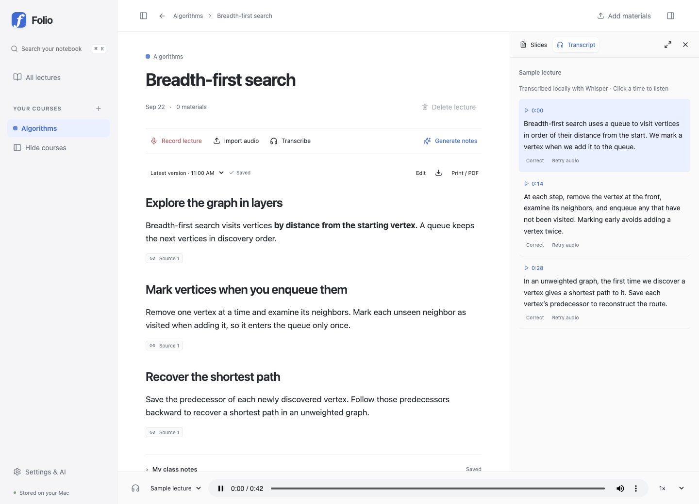

# Folio

Folio is a lecture notebook I built to make it easier to study from recordings and slides. It transcribes audio on my Mac using Whisper large-v3, then generates notes that link back to the relevant slide or transcript passage.

*Sample lecture data. Selecting a note’s citation highlights the corresponding transcript passage.*

## How it works

1. Create a lecture, import slides, and record or upload audio.
2. Run Whisper locally. Slide text can supply vocabulary for the transcription.
3. Generate structured notes. Open a citation to inspect the original slide or the timestamped passage.
4. Correct the transcript or edit the notes. Folio preserves earlier note revisions and flags notes that need to be refreshed after a transcript correction.

## What I built

I built the recording and recovery workflow, the local transcription pipeline, and the notebook interface. The app saves audio in chunks during recording and uses SQLite to keep lecture material, transcripts, notes, and revisions together.

Folio processes audio locally for standard transcription. The optional note-generation step sends transcript text and relevant slide content to OpenAI.

**Stack** · TypeScript, React, Node.js, SQLite, Whisper, OpenAI
